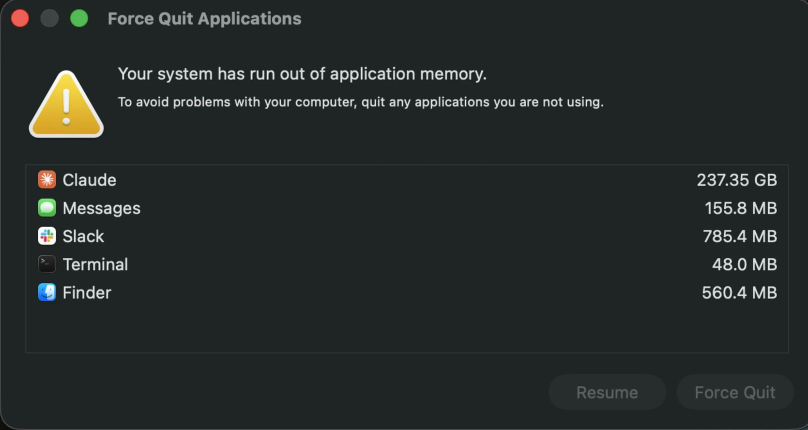
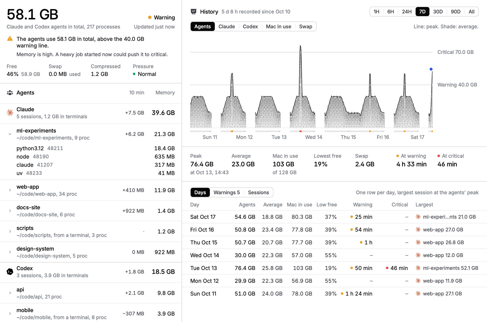
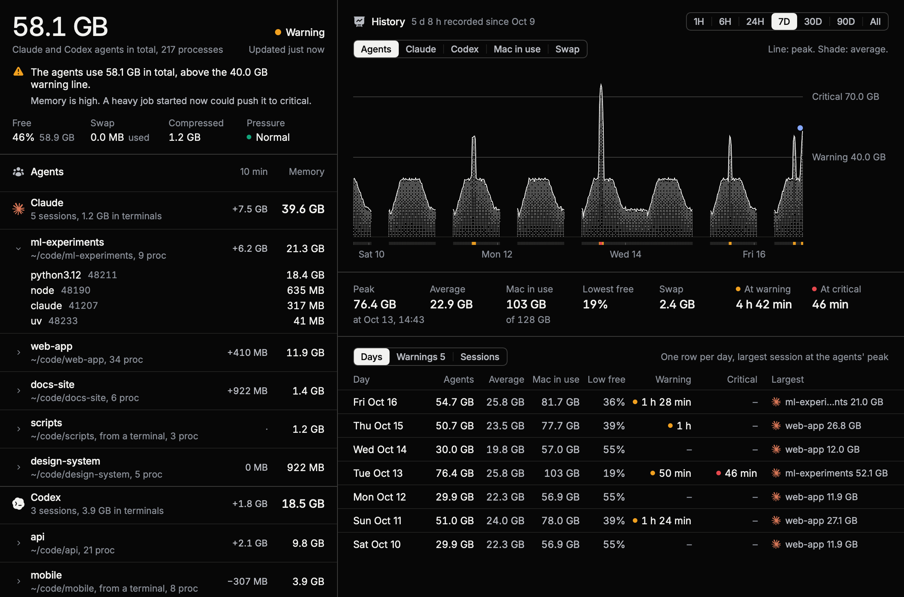
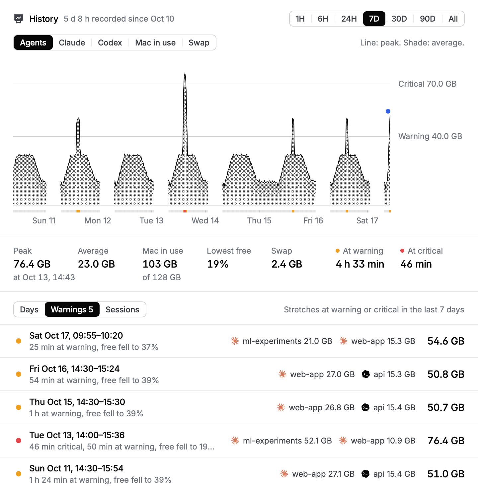
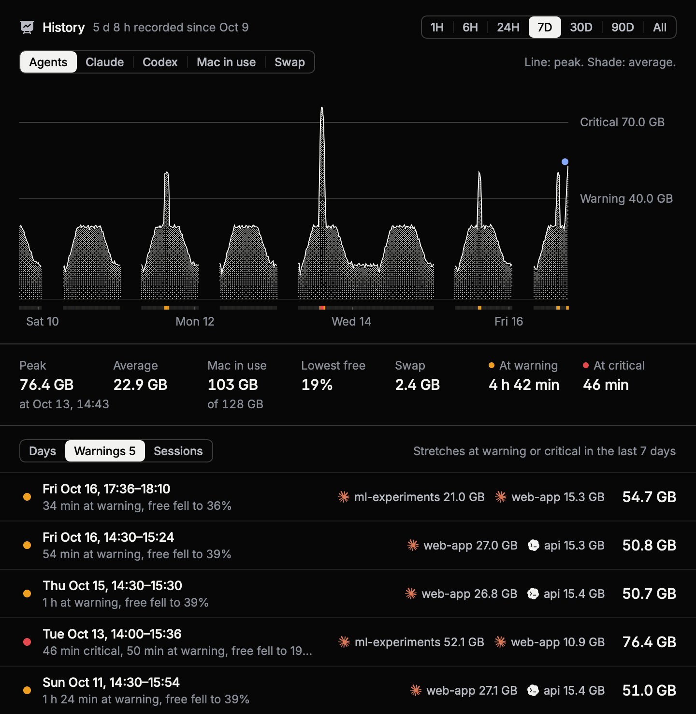
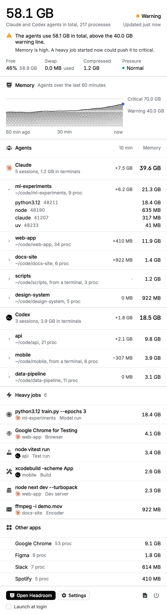
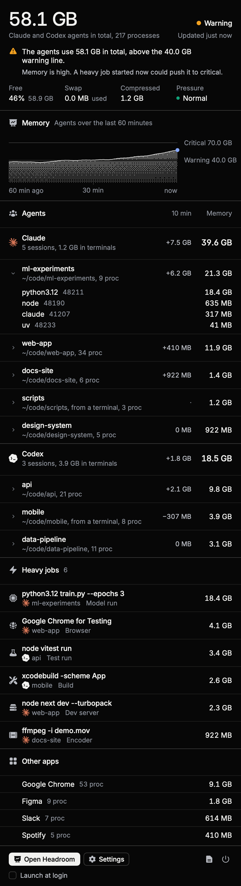
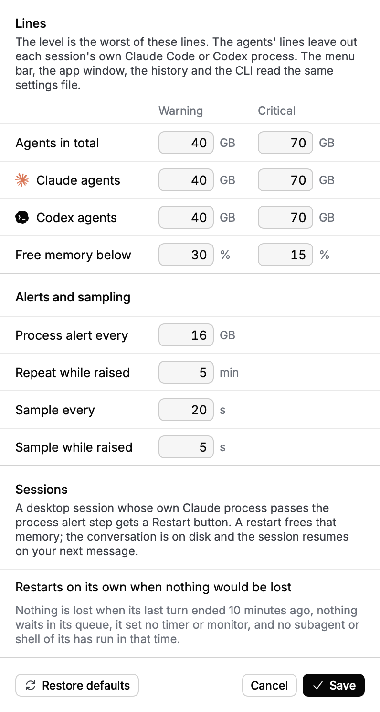
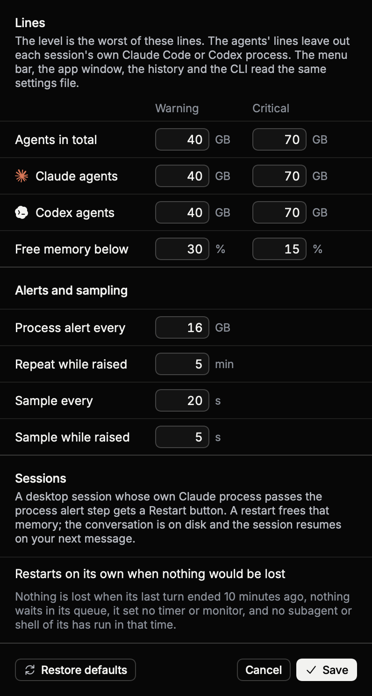
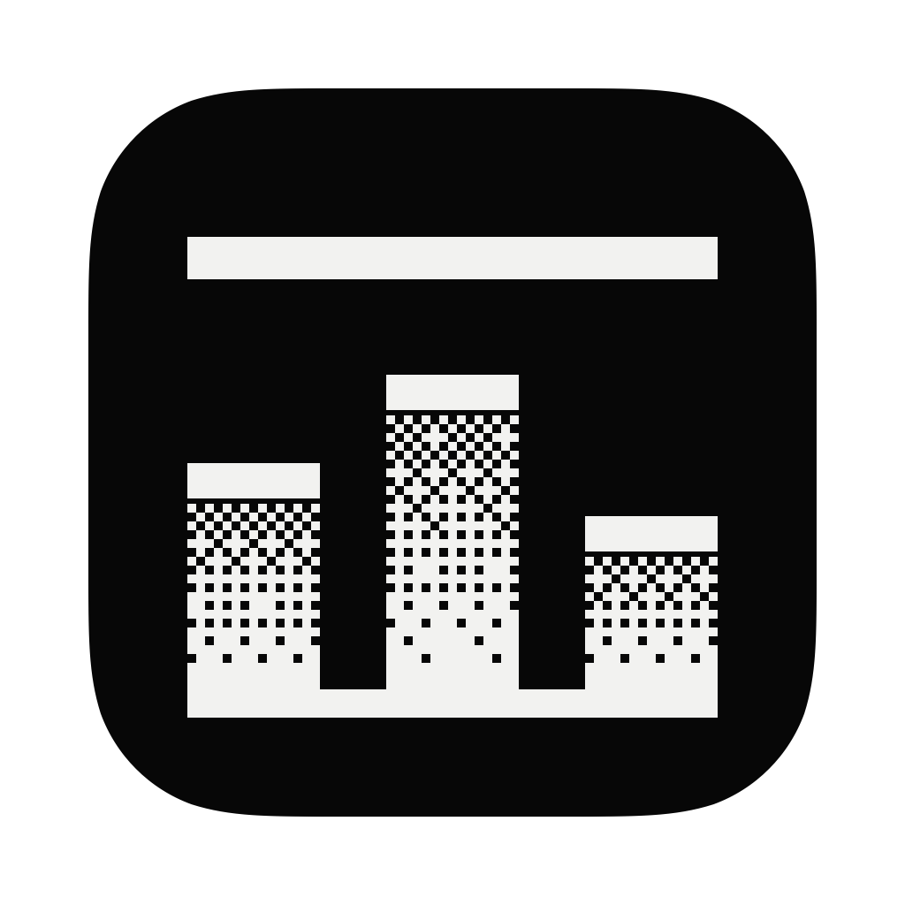

# Headroom



Headroom is a macOS app that shows how much memory the Claude and Codex desktop apps, their agent sessions and every process those sessions start are using, and keeps a record of it. A menu bar item shows the agents' total at a glance. The app window shows memory now beside its history: a chart from the last hour to the whole record, the peaks, the time spent at warning and critical, and the days, warnings and sessions behind them. Headroom only reads memory. It never stops, pauses or signals a process, and it takes no messages from agents.

## Screenshots

These screenshots show a made-up machine and a made-up week. The Claude agents use 39.6 GB and the Codex agents 18.5 GB, so together they cross the 40 GB warning line at 58.1 GB. Over the week, builds pushed the agents past the warning line on three afternoons and a training run went critical on Tuesday. The images are rendered with `HeadroomApp --render docs --demo`, which fixes the clock so both themes show the same times. Without `--demo`, the same command renders the live state and record of the Mac it runs on.





| Light | Dark |
| --- | --- |
|  |  |
|  |  |
|  |  |
|  |  |

The menu bar images are 2x crops. The app icon is three bars that stand on a floor under a ceiling line. The gap between the tallest bar and the line is the headroom.



## Why it exists

The Claude desktop app owns every Claude Code session it starts, and the Codex app owns every Codex session it starts. Each app also owns every process those sessions start: MCP servers, test runners, browsers, encoders and model runs. When 25 sessions run at once, the Force Quit dialog shows all of that memory under one name, Claude or ChatGPT. On the Mac this app was written for, one runaway node process reached 457 GB and the system ran out of application memory twice in one day. Headroom shows which session and which process owns the memory, and its record shows when memory ran high, for how long and because of what.

## What it watches

Headroom takes a sample every 20 seconds, and every 5 seconds while memory is high. Each sample reads these values:

- Free memory from `kern.memorystatus_level`, as a percentage of total memory.
- Memory pressure from `kern.memorystatus_vm_pressure_level` and from a `DispatchSource` memory pressure source, which also triggers an immediate sample.
- Swap used from `vm.swapusage`, compressed memory from `host_statistics64` and total memory from `hw.memsize`.
- The physical footprint of every process from `proc_pid_rusage` (`RUSAGE_INFO_V4`, `ri_phys_footprint`). This is the number Activity Monitor shows.
- The parent pid, path, start time and working directory of each process from libproc.

Headroom builds the process tree from the parent pids and attributes memory to two agent apps.

| App | The app's processes | A session is |
| --- | --- | --- |
| Claude | The `Claude.app` process plus all its descendants. | A Claude Code process, whose executable path contains `claude-code/` and ends in `claude`, together with its descendants. |
| Codex | The process of the app bundle named ChatGPT or Codex whose identifier is `com.openai.codex`, plus all its descendants. On macOS that bundle is `ChatGPT.app`. Every `codex app-server` process also counts, with its descendants, including the shared daemon that launchd adopts. | A thread of the Codex app, or a `codex` process that runs an agent, together with its descendants. |

Each app's total counts every process of that app's agents once: the app's processes and the app's sessions started from terminals. A process counts toward one app only, so the Claude total plus the Codex total is the agents' total, and an app's total is never smaller than the sessions listed under it. The windows and `headroom status` also show how much of each total runs in terminals.

Codex runs in three ways, and Headroom reads the subcommand from each `codex` process's arguments to tell them apart.

- The Codex app's threads run inside one `codex app-server` process, either a child of the app or the shared daemon (`codex app-server daemon`). Each thread runs its commands in the thread's folder, so Headroom groups the app server's direct children by working directory and lists each folder as a session. Such a session has no process of its own; its `pid` in `state.json` is negative and stays the same for one app server and folder. The app server itself is not a session.
- The interactive CLI, `codex exec`, `codex review`, `codex resume` and `codex fork` are sessions. The executable is named `codex` in the Codex app (`ChatGPT.app/Contents/Resources/codex-cli/CodexCLI.app/Contents/MacOS/codex`) and in the npm package `@openai/codex`, and `codex-aarch64-apple-darwin` in the Homebrew cask. The npm launcher, `node .../@openai/codex/bin/codex.js`, counts toward the session it starts.
- Other subcommands, such as `codex app-server proxy`, `codex mcp`, `codex login` and `codex sandbox`, and helpers such as `codex-code-mode-host`, are not sessions. Their memory counts toward the session or app server above them, if any.

Each session is labelled by its working directory, so a person can see which project owns the memory. A session in the home folder is labelled Home folder. A process belongs to the nearest session above it, so a session started inside another session keeps its own processes. A session started from a terminal belongs to the app whose agent it runs, even though it is outside that app's process tree.

For each session and each app Headroom also shows the change in memory over the last 10 minutes. A change shows once Headroom has 10 minutes of samples; until then the column shows a dot.

Headroom also lists heavy jobs: browsers, model runs, encoders, builds, test runs, dev servers and containers above 256 MB. A heavy job is the topmost matching process with its whole subtree. The windows also show the memory totals of other apps, and the CLI prints the largest processes overall.

macOS does not let an unprivileged app read the footprint of processes owned by other users, such as `WindowServer` and `kernel_task`. Headroom counts them as unreadable and leaves them out of the totals. Every Claude and Codex process belongs to the person, so the agent totals are complete.

## Levels

Headroom watches three totals: all agents together, the Claude agents and the Codex agents. On a new install each has a warning line at 47 percent of the Mac's memory and a critical line at 70 percent, rounded to 5 GB, so a 128 GB Mac warns at 60 GB and turns critical at 90 GB, and a 32 GB Mac at 15 and 20 GB. Free memory and the system's memory pressure have their own lines. The level is the worst of them.

The agents' lines measure the agents' work: everything in an app's total except the sessions' own Claude Code and Codex processes. A session's own process grows with its conversation and only a restart frees it, so counting it would keep the level up for as long as one session stayed bloated. A session whose own process passes 16 GB, or that keeps half a CPU core busy for 10 minutes, gets a note under the level instead. Free memory and pressure still count everything.

| Level | When |
| --- | --- |
| ok | No line is crossed. |
| warning | The agents', Claude's or Codex's work reaches its warning line, free memory is below 30 percent, or the system reports memory pressure while free memory is below 30 percent. |
| critical | The agents', Claude's or Codex's work reaches its critical line, free memory is below 15 percent, or the system reports critical pressure. |

The settings window changes every line and the sampling. Settings are stored in `~/Library/Application Support/Headroom/settings.json`, so the CLI uses the same lines as the app.

Headroom posts a notification each time the level gets worse, naming the largest sessions and processes. While the level stays at warning or critical, the notification repeats every 5 minutes. When the level returns to ok for three samples in a row, Headroom posts a recovery note. It also posts a notification each time a single process crosses another 16 GB step. Clicking a notification opens the app window. When macOS does not let Headroom post its own notifications, Headroom posts the same text as a banner through osascript.

## The record

Every sample folds into the minute it falls in. When a minute ends, Headroom writes it as one line to `history/<day>.jsonl` in its folder, one file per local day, and when an hour ends, it writes the hour as one line to `history/hours.jsonl`. Each line holds:

- for the agents, Claude, Codex, the Mac's memory in use and free memory: the lowest, average and highest value, written as `[min, avg, max]`;
- the most swap and compressed memory, and the Mac's total memory;
- the worst level, and the minutes with samples, at warning and at critical (a minute counts once, at its worst level);
- when the agents' total peaked, and the three largest sessions and processes at that moment.

Minutes are kept for 90 days and hours for good. A minute's line is about 600 bytes, so a day of minutes is under 1 MB and a year of hours about 5 MB. When the Mac sleeps or Headroom is not running, nothing is written and nothing is filled in, so gaps show as gaps. After a quit or a crash, the next start writes any hour it missed from the minutes on disk.

The first start of version 2 also builds the record's first days from version 1's log: version 1 wrote a summary of every sample to `events.jsonl` and `events.1.jsonl`, with the totals, free memory, swap, the advice and the three largest sessions and processes. Those samples become minutes and hours before the record's first minute, with hold read as warning, once; `history/.imported-v1` marks it done.

`history.jsonl` beside it holds every sample of the last 60 minutes for the menu bar window's chart.

## The app window

Open it from the menu bar window's Open Headroom button, by opening Headroom again from Finder or Spotlight, or by clicking a notification. Headroom also opens it when the person starts the app, but not when it starts at login. While the window is open, Headroom has a Dock icon and menus; when it closes, Headroom goes back to the menu bar.

The left column is memory now, in the menu bar window's rows: the agents' total and level with its reasons, free memory, swap, compressed memory and pressure, then Claude and Codex with their sessions, the heavy jobs and other apps.

The right column is the history:

1. **Range**: 1 hour, 6 hours, 24 hours, 7 days, 30 days, 90 days or the whole record. ⌘1 to ⌘7 choose them, and ⌘R reloads.
2. **Measure**: the agents together, Claude, Codex, the Mac's memory in use, or swap.
3. **Chart**: each point covers a stretch of time, from one minute for the last hour to a day for a long record. The ink line is the stretch's peak and the dithered area its average. The warning and critical lines are hair rules; for memory in use they are the free memory lines, under a rule at the Mac's total memory. A strip under the chart marks where the record has samples, and, in amber and red, the minutes at warning and critical. Hovering shows a stretch's time, peak and average, level, and the largest sessions at its peak.
4. **Figures** for the range: the peak and when it happened, the average, the most memory in use, the lowest free memory, the most swap, and the time at warning and at critical.
5. **Lists**: Days, one row per day with its peak, average, memory in use, lowest free memory, time at warning and critical, and the largest session at the peak; Warnings, each stretch at warning or critical with its time, peak and the two largest sessions, where dips back to ok shorter than 5 minutes belong to the stretch; and Sessions, ranked by their largest total in the range, with how long each was among the three largest.

Warnings need minutes, so they reach back 90 days at most. The window reloads its range every minute while it is open, and releases everything it read when it closes.

## The menu bar

The menu bar item shows a small gauge, the agents' total in GB and a dot. The gauge's column fills toward its top line as the agents' total nears the critical line, so the empty part under the line is the headroom, and a tick on its left marks the warning line. The dot is green for ok, amber for warning and red for critical. A click opens the menu bar window under the item: the same head and lists as the app window's left column, a chart of the agents over the last 60 minutes, and a footer with Open Headroom, Settings, the event log, Quit Headroom and Launch at login. Each list shows six rows until Show more is clicked. A click outside the window or the Escape key closes it. Launch at login uses `SMAppService` and is off until it is turned on.

## Command line

The `headroom` command works without the app. When `state.json` is older than 60 seconds, it samples the Mac directly. The record is written only by the app.

```sh
headroom status                 # the level, the agents' totals, free memory, sessions by app, heavy jobs
headroom status --json          # the same document as state.json
headroom history                # the last 24 hours in up to 36 rows: peak, average, level and largest session
headroom history 7d             # any range: 1h, 6h, 24h, 7d, 30d, 90d, all, or Nh or Nd
headroom days 30d               # one row per day
headroom episodes 7d            # each stretch at warning or critical
headroom events --follow        # the app's log: starts, alerts, pressure changes and settings
headroom doctor                 # the app's state file, the record's files and a direct sample
```

`history`, `days` and `episodes` take `--json` and print the rollups.

Two commands are for scripts that start large jobs and want to check first. They read the same levels and change nothing.

```sh
headroom can-start --gb 8       # exit 0 when an 8 GB job fits now, 1 when not
headroom wait --gb 8 --timeout 20 && ffmpeg -i in.mov out.mp4
```

A job fits when the level is ok, the free memory after it stays above the warning line, and the agents' work after it stays below the agents' critical line. `wait` checks every 10 seconds and exits with code 75 when the timeout passes.

## Upgrading from 1.x

Version 2 removes everything that agents talked to: the local HTTP API on port 7341 and its token, the MCP server, the `PreToolUse`, `SessionStart` and `UserPromptSubmit` hooks, agent notes and requests with their Approve and Deny buttons, session watch and rescue, the runaway guard, and the window's Pause, Quit and Restart buttons. `headroom hook` now exits 0 with no output, so a hook that is still configured lets every command run; remove it from `~/.claude/settings.json` or `~/.codex/config.toml`. `headroom note`, `request`, `mcp`, `sessions`, `session`, `rescue` and `guard` say they were removed and exit 1; remove a `headroom` MCP server with `claude mcp remove headroom` or `codex mcp remove headroom`. `scripts/build-app.sh` removes the guard's LaunchAgent, `com.kevinliu.headroom.guard`, if it is installed.

Version 1's files stay in `~/Library/Application Support/Headroom` until they are deleted by hand: `token`, `guard.json`, `guard-state.json`, `hook-warned.json`, `sessions.json`, `sessions-scan.json`, `sessions-history.jsonl`, `recovery/` and `rescues/`. The record starts with version 2; version 1 kept only the last 60 minutes.

In `state.json`, version 3 replaces `advice` (ok, hold, critical) with `level` (ok, warning, critical) and drops `pendingRequests` and `notes`.

## Install

Headroom needs macOS 14 or later and Swift 6. The build script builds in release, assembles `Headroom.app` with its icon, signs it ad hoc, installs it to `~/Applications`, installs the CLI to `~/.local/bin/headroom` and launches the app, which opens its window.

```sh
scripts/build-app.sh
```

`scripts/build-app.sh --no-launch` installs without launching. `scripts/build-app.sh --no-install` only assembles `build/Headroom.app`. Launch at login stays off until it is turned on in the menu bar window. `Headroom --background` starts in the menu bar without opening the window.

Headroom asks for permission to post notifications at its first launch. On macOS 26.4 an ad hoc or self-signed build receives the answer "Notifications are not allowed for this application", and no Headroom entry appears in the notification settings. A build signed with a Developer ID should be allowed. Set `HEADROOM_SIGN_IDENTITY` to the identity's name before running `scripts/build-app.sh` to sign with it. Until then, Headroom falls back to osascript banners.

`build-app.sh` copies the Inter font and its license into the app bundle. Run the tests with `swift test`. Render the screenshots with `~/Applications/Headroom.app/Contents/MacOS/Headroom --render docs`. From a checkout, `swift build -c release` builds the app as `.build/release/HeadroomApp`. On a case-insensitive disk `.build/release/Headroom` is the CLI. `HeadroomApp --snapshot-window <file>.png` opens the live menu bar window after one sample, writes it to the file and exits, and `--snapshot-app <file>.png` does the same for the app window once its history has loaded. Neither writes state, the record or the log.

## Look

The windows use the tokens, type and line rules of the General Translation brand deck. Light is a white surface with ink `#070707` text and dark is an ink surface with `#f2f2f0` text. Text has three steps: ink, ink-2 and titanium. Lists are ruled rows with a 9 percent line between rows and an 18 percent line between sections, drawn edge to edge. In dark mode the lines are 10 and 22 percent, as in the deck's dark theme. Every row has one 16 point leading slot for its icon, mark or chevron, so every title starts at the same edge, and every figure ends at the same right edge. Section heads have more space under them than above them. Controls round at 6 points and the windows stay square. Colour appears only on icons, the status dots and the level strip under the history chart: green for ok, amber for warning and red for critical. GT blue marks the current value on a chart. A chart's area is an ordered dither on an 8 by 8 Bayer screen, one cell per point, and it is the windows' only texture.

The type is rsms InterVariable 4.1, bundled in `Resources/Fonts` with its SIL Open Font License and registered at launch. Weights stop at 500. The totals use tabular figures with the `cv11` and `ss01` features, and tracking tightens with size. Meaning icons are Heroicons 20 solid (MIT). The Claude mark (CC0, from thesvg.org) keeps its own colour, `#D97757`, and the Codex mark (MIT, from thesvg.org) takes the text colour. Both marks belong to their owners and label the apps they name.

## Footprint

Headroom's own memory and CPU use were measured for version 1 on 2026-10-12 on a 128 GB Mac with about 1,000 processes and 12 agent sessions, under a load average between 140 and 240. Version 2 samples the same way and adds one appended line a minute.

| Measure | Result | Method |
| --- | --- | --- |
| Physical footprint, windows closed | 15 to 16 MB | `footprint -p <pid>` every 10 seconds for 2 minutes |
| Physical footprint, menu bar window open | 37 MB in 5 of 7 runs; 86 MB and 102 MB in the other 2, at a load average near 280 | `proc_pid_rusage` in `--snapshot-window` runs on 2026-10-13 |
| CPU, windows closed | 0.48 to 0.69 percent over 2 minutes | CPU time from `ps -o time` divided by wall time, in two runs |
| One sample | 83 ms for 985 processes in one run, and 980 ms for 1,013 processes at a load average of 244 | `headroom doctor`, which samples without the app's cache |
| Version 2, app window open | 54 MB after it settles | `footprint -p <pid>` on 2026-10-16, a minute after launch |

When a window first appears, macOS charges the process for the window's graphics memory; on the 2026-10-16 Mac this reached 185 MB for about a second, as "Owned physical footprint (unmapped) (graphics)", and became reclaimable once the window was drawn. The windows exist only while they are open. Closing one releases its views and, for the app window, the history it read, so a closed window costs no memory and no drawing per sample.

## Privacy

Everything stays on the Mac, and Headroom makes no network requests and listens on no port. The state, the settings, the record and the log are files in `~/Library/Application Support/Headroom` that only the person's account can read. Headroom reads process paths, the arguments of interpreters such as node and python and of `codex` processes, the working directories of agent sessions and of the Codex app server's direct children, and the `Info.plist` of app bundles named ChatGPT or Codex to find the Codex app. The record holds session folder names and process names with their memory; the log holds alerts, which name the same. Neither holds file contents or command lines.

## License

Headroom is released under the MIT license. See [LICENSE](LICENSE).
